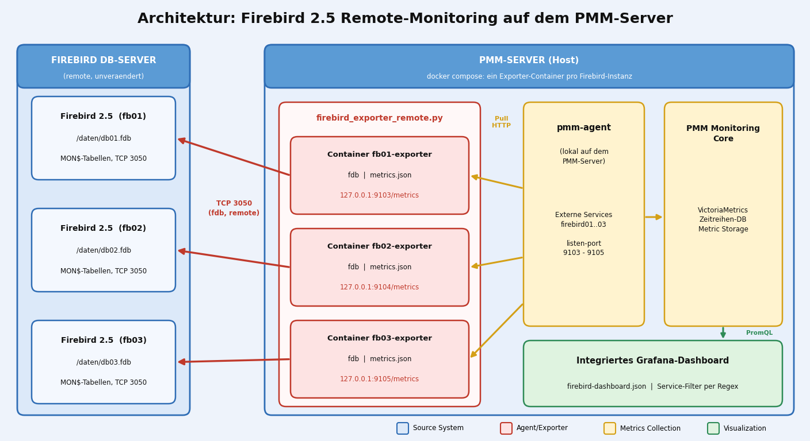

# Firebird 2.5 Prometheus Exporter & PMM Integration (Remote-Variante)

[](https://www.python.org/)
[](https://www.firebirdsql.org/)
[](https://prometheus.io/)
[](https://docs.docker.com/compose/)
[](https://opensource.org/licenses/MIT)

A lightweight, modular Python-based Prometheus Exporter for **Firebird 2.5**, running **centrally on the PMM server** and accessing the databases **remotely**. One Docker container per Firebird instance, each on its own port, each registered with the local PMM agent. Nothing has to be installed on the database hosts.

---

## 🏗️ Architecture Overview

Auf den Firebird-Servern läuft nichts mehr. Pro Datenbank startet `docker compose` auf dem PMM-Server einen eigenen Exporter-Container, der sich per TCP (Port 3050) mit den `MON$*`-Tabellen verbindet. Der lokale `pmm-agent` fragt jeden Container über einen eigenen Port ab und liefert die Daten an PMM und Grafana.



---

## 🚀 Features
* **Ein Container pro Instanz:** Jede Firebird-Datenbank hat ihren eigenen Exporter, Ausfälle oder fehlerhafte Queries bleiben isoliert.
* **Remote-Zugriff:** Verbindung per `fdb` über `host/port:pfad`, inklusive TCP-Vorprüfung mit Timeout, damit ein toter Host den Scrape nicht blockiert.
* **Transaction Counter Monitoring:** Tracks `MON$NEXT_TRANSACTION`, `MON$OLDEST_TRANSACTION` (OIT) und `MON$OLDEST_ACTIVE` (OAT).
* **Garbage Collection Lag Detection:** Berechnet den Transaction Gap (`Next - OIT`).
* **Dynamic Custom Metrics:** Eigene SQL-Abfragen über `metrics.json` (gleiches Format wie bisher).
* **Konfiguration per Umgebungsvariablen:** Ein Image für alle Instanzen, Zugangsdaten in `.env` oder als Docker Secret.
* **PMM & Grafana Ready:** Mitgeliefertes Dashboard, Auswahl der Instanz per Service-Regex.

---

## ⚙️ Installation & Setup (German / Deutsch)

### 1. Voraussetzungen
Auf dem PMM-Server werden nur Docker mit dem Compose-Plugin und der PMM-Client (`pmm-agent`, `pmm-admin`) benötigt. Python und Firebird-Client stecken im Image.

Vom PMM-Server muss der Firebird-Port (Standard `3050`) jeder Datenbank erreichbar sein:
```bash
nc -zv db01.example.local 3050
```

Der Datenbankbenutzer muss alle Verbindungen sehen dürfen. In Firebird 2.5 liefern die `MON$`-Tabellen für normale Benutzer nur die eigene Sitzung, deshalb `SYSDBA` oder den Datenbankbesitzer verwenden.

### 2. Projekt und Konfiguration
Lege den Projektordner auf dem PMM-Server an (z. B. `/opt/firebird-exporter-pmm`):
* `firebird_exporter_remote.py` (Das Hauptskript)
* `metrics.json` (Metrik-Definitionen und Custom Queries)
* `Dockerfile` und `docker-compose.yml`
* `.env` (Zugangsdaten, Vorlage `env.beispiel`)

```bash
cp env.beispiel .env
chmod 600 .env
nano .env
```

**Beispiel `.env`:**
```ini
FB01_HOST=db01.example.local
FB01_PORT=3050
FB01_DATABASE=/daten/db01.fdb
FB01_USER=SYSDBA
FB01_PASSWORD=dein_passwort
```

Pro Instanz gibt es einen Block `FBnn_*`. Weitere Datenbanken ergänzt du in `docker-compose.yml`, indem du einen Service kopierst und Name, Port und `FBnn_*`-Variablen anpasst:

| Instanz | Container | Port | Service-Name in PMM |
|---|---|---|---|
| fb01 | `fb01-exporter` | 9103 | `firebird01` |
| fb02 | `fb02-exporter` | 9104 | `firebird02` |
| fb03 | `fb03-exporter` | 9105 | `firebird03` |

Die Ports werden nur auf `127.0.0.1` veröffentlicht, von außen sind die Exporter nicht erreichbar.

**Alle Umgebungsvariablen des Exporters:**

| Variable | Default | Bedeutung |
|---|---|---|
| `FB_HOST` | (Pflicht) | Hostname oder IP des Firebird-Servers |
| `FB_PORT` | `3050` | Firebird-Port |
| `FB_DATABASE` | (Pflicht) | Pfad oder Alias der Datenbank auf dem Server |
| `FB_USER` | `SYSDBA` | Benutzer |
| `FB_PASSWORD` | (Pflicht) | Passwort, alternativ `FB_PASSWORD_FILE` (z. B. Docker Secret) |
| `FB_CHARSET` | `UTF8` | Zeichensatz |
| `FB_CONNECT_TIMEOUT` | `5` | Timeout der TCP-Vorprüfung in Sekunden |
| `EXPORTER_PORT` | `9103` | Port des `/metrics`-Endpunkts im Container |
| `EXPORTER_LISTEN_ADDR` | `0.0.0.0` | Listen-Adresse im Container |
| `SCRAPE_CACHE_SECONDS` | `15` | Cache-Dauer, mehrere Scrapes innerhalb dieser Zeit belasten die DB nur einmal |
| `INSTANCE_NAME` | `FB_HOST` | Name für Log-Zeilen und die Metrik `firebird_exporter_info` |
| `METRICS_FILE` | `metrics.json` | Pfad der Metrik-Definitionen |

### 3. Starten
```bash
docker compose up -d --build
docker compose ps
docker logs --tail 20 fb01-exporter
curl -s http://127.0.0.1:9103/metrics | grep -E '^firebird_(up|scrape|exporter_info)'
```

`firebird_up 1.0` bedeutet, dass die Verbindung zur Datenbank funktioniert. Bei `0.0` steht der Grund im Log des Containers (Host nicht erreichbar, falsches Passwort, falscher Pfad).

### 4. Integration in PMM
Der lokale PMM-Agent registriert jeden Exporter-Port einmalig als **External Service**:
```bash
pmm-admin add external \
  --service-name=firebird01 \
  --group=firebird \
  --listen-port=9103 \
  --metrics-path=/metrics

pmm-admin add external \
  --service-name=firebird02 \
  --group=firebird \
  --listen-port=9104 \
  --metrics-path=/metrics

pmm-admin add external \
  --service-name=firebird03 \
  --group=firebird \
  --listen-port=9105 \
  --metrics-path=/metrics
```

Prüfen mit `pmm-admin list`. Nach ein bis zwei Minuten liefert die Abfrage `firebird_up` in PMM unter *Explore* für jeden Service einen Wert.

Läuft der PMM-Agent selbst in einem Container und nicht auf dem Host, erreicht er `127.0.0.1` nicht. Dann nimmst du stattdessen die URL über die Host-Adresse (die Ports müssen dafür auf `0.0.0.0` oder die Docker-Bridge veröffentlicht sein):
```bash
pmm-admin add external-serverless \
  --external-name=firebird01 \
  --group=firebird \
  --url=http://<pmm-host>:9103/metrics
```

### 5. Update und Betrieb
```bash
git pull
docker compose up -d --build
```

Änderungen an `metrics.json` oder `.env` brauchen nur einen Neustart: `docker compose restart` bzw. `docker compose up -d` bei geänderter `.env`.

Eine neue Instanz hinzufügen: Service in `docker-compose.yml` kopieren, `FBnn_*` in `.env` ergänzen, `docker compose up -d` und `pmm-admin add external` mit dem neuen Port.

---

## 🧪 Testen der Exporter

Die Testroutine `test_exporter.py` prüft für jeden Port, ob `/metrics` mit HTTP 200 antwortet, `firebird_up 1.0` meldet und die Kernmetriken enthalten sind.

```bash
python3 test_exporter.py
# andere Ports:
EXPORTER_PORTS="9103,9104" python3 test_exporter.py
```

---

## 🇬🇧 English Documentation

### Features
* **One container per instance:** Each Firebird database gets its own exporter on its own port.
* **Remote access:** Connects over TCP to the database, nothing is installed on the DB hosts.
* **Transaction Monitoring:** Transaction counters, OIT, OAT and the garbage collection gap.
* **Custom Queries:** Extend monitoring easily using `metrics.json`.

### Quick Start
1. Copy `env.beispiel` to `.env` and enter host, path and credentials of every Firebird instance.
2. Start all exporters on the PMM server: `docker compose up -d --build`
3. Check each endpoint: `curl http://127.0.0.1:9103/metrics` (then 9104, 9105, ...)
4. Register every port with the local PMM agent: `pmm-admin add external --service-name=firebird01 --group=firebird --listen-port=9103`

### Differences to the on-host exporter
* Runs on the PMM server instead of the DB host, reaches Firebird via `host/port:path`.
* Configured by environment variables instead of `config.json`.
* No `firebird_disk_*` metrics: a remote exporter cannot read the disk of the DB host. Use the `node_exporter` of the DB host (PMM node monitoring) for disk space.

---

## 📊 Dashboard

Das mitgelieferte Grafana-Dashboard zeigt auf einen Blick, wie es einer Firebird-2.5-Datenbank geht:

- **Status:** Firebird up/down, Verbindungen, älteste aktive Transaktion, Transaction Gap, Cache-Hit-Ratio
- **Verbindungen und Transaktionen:** Verläufe für OIT, OAT, OST, Gap, Transaktionen pro Sekunde und Langläufer
- **Cache und I/O:** Cache-Trefferquote und Seitenzugriffe
- **Datensätze:** Einfügungen, Änderungen, Löschungen, sequentielle gegen indexierte Lesezugriffe, Garbage Collection
- **Speicher:** Datenbankgröße und Speicherverbrauch

**Einrichten:** In PMM unter *Dashboards → New → Import* die Datei `firebird-dashboard.json` hochladen, die Datenquelle **Metrics** wählen und bestätigen. Mehrere Datenbanken trennst du im Feld **Service (Regex)**, zum Beispiel `firebird01.*`.

Hinweis: Die Plattenplatz-Kacheln des Dashboards bleiben in dieser Variante leer, weil die Metriken `firebird_disk_*` remote nicht verfügbar sind.

🇬🇧 *The bundled Grafana dashboard shows the health of a Firebird 2.5 database at a glance: status tiles, connections and transactions, cache and I/O, record activity and storage. Import `firebird-dashboard.json` via Dashboards → New → Import in PMM, choose the **Metrics** data source, and filter instances with the **Service (Regex)** field. The disk space panels stay empty in this remote variant.*

## 📄 License
This project is licensed under the MIT License.
